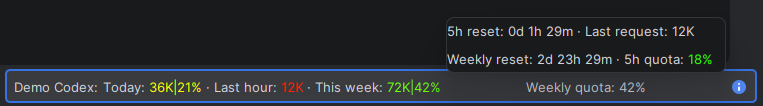
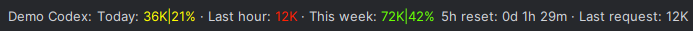

# AI Usage Trackers

Track local AI token usage in the IntelliJ IDEA status bar. Start with the
**Today** and **This week** trackers, or create trackers for your own time periods.

**Claude and Antigravity support is experimental.** Contributors with subscriptions
are needed to test it with real usage before verified support can be claimed.

For technical details, see [TECHNICAL.md](TECHNICAL.md).

For building and contributing, see [CONTRIBUTING.md](CONTRIBUTING.md).

Usage data stays local; the plugin does not send it to servers. See the
[Privacy Policy](PRIVACY.md) for data handling and deletion information.

Usage data stays local; the plugin does not send it to servers. See the
[Privacy Policy](PRIVACY.md) for data handling and deletion information.

## Screenshots

## Install

Requires IntelliJ IDEA **2026.3**.

1. Open **Settings > Plugins** in IntelliJ IDEA.
2. Open the gear menu and choose **Install Plugin from Disk…**.
3. Select `ai-usage-trackers-<version>.zip` and restart the IDE if prompted.

See [JetBrains' installation guide](https://www.jetbrains.com/help/idea/managing-plugins.html#install_plugin_from_disk)
for more help.

## Get started

Open **Settings > Tools > AI Usage Trackers**, or click the vendor name in the status
bar and choose **Settings**.

If you haven’t agreed to local usage processing, click **Review usage agreement**
in the status bar. In **General**, review the disclosure and **Privacy Policy**.
To start processing, select **I agree to local usage processing** and click
**Apply** or **OK**. To withdraw agreement, clear the checkbox and apply. This
stops processing and retains saved history. Agreement is specific to this IDE
installation and excluded from settings sync and configuration exports.

Codex is selected for tracking by default and searches for local Codex logs
automatically after agreement. In **General**, use **Track usage** to turn collection on or off
and **Widget prefix** to change the name shown before the values.

For experimental Claude or Antigravity support, additional accounts, or custom folders, open
**Advanced > Accounts and usage sources**:

1. Choose the vendor and account, or select **Add account**.
2. Add that account's usage folders or files. Keep each account's folders separate.
3. Confirm that the sources belong to the account.
4. Select **Create default trackers for this account** if it has no trackers.
5. Enable **Track usage** for the vendor in **General** and save with **Apply** or **OK**.

Use **Setup instructions…** for vendor-specific steps, including how to use
**Export capture helper and instructions…** for Claude and Antigravity.

Use **Remove account** to remove an unused account after reassigning or removing
its trackers. Imported history is retained. Keep at least one account per vendor;
the original Codex account cannot be removed.

Hover over a setting for a short explanation. Click a category's help icon to
show more help beside its settings, or click its title to collapse or expand it.

## Choose what to display

Use **Displayed vendor** in General, or the widget's **Agents** menu, to switch
between configured, enabled vendors. Other enabled vendors keep collecting usage.
Turn on **Multi-vendor carousel** to rotate between selected vendors automatically.
While hovering the widget, use **Alt+Left/Right** to cycle carousel agents. Scroll
over the agent name or drag it (vertically for Vertical step, horizontally for
other modes) to change agents; dragging applies when you release the button.
Scroll or drag over the agent's ribbon to move through that agent's entries.

The widget follows the IDE's light or dark theme. While hovering the widget,
its agent shortcuts leave the focused editor or tool window unchanged.
If a display change temporarily prevents pointer detection, automatic movement
pauses and resumes when detection recovers.

Each tracker counts usage for its selected account. Choose that account in the
tracker editor. The **Quota account** selector chooses which account's quota
settings you edit.

## Set up trackers

In **Trackers**, add, duplicate, remove, rename, hide, or reorder trackers. Use
the list's move buttons or drag trackers into the order you want. The toolbar
also sorts trackers by duration, shortest first or longest first.

Choose a period type:

- **Calendar periods** count minutes, hours, days, weeks, or months along calendar
  boundaries. Calendar weeks begin on Monday.
- **Elapsed duration** counts a rolling period in minutes, hours, days, or weeks,
  such as the last 24 hours.
- **Provider reset-aligned week (all days)** follows the selected weekly quota reset.
- **Provider reset-aligned 5 hours** follows the selected five-hour quota reset.
  Set **Unit** to **Hours** and **Amount** to **5** to see the option on an account
  with a supported five-hour quota scheme.

Calendar-day trackers can include all days, Monday–Friday, or days with usage.
For a tracker set to one current calendar day, **Also reset daily usage at weekly
reset** starts the count over when the selected weekly quota resets. The usual
midnight boundary applies on other days and when the reset time is unavailable.
Reset-aligned weeks include weekends and holidays. Choose a time zone, or leave
it blank to use your computer's time zone.

The default tracker limit is five. Raise **Advanced > Tracker limit** to use up
to 32 trackers.

Select **Apply** or **OK** to save tracker changes. **Cancel** discards them.

## Customize the widget

In **Appearance**, change the font size, date and time formats, colors, and
scrolling ribbon. The ribbon is the scrolling area for usage values. Choose
smooth scrolling or steps, and adjust its width and speed or interval.

For each tracker, **Placement** lets you keep it fixed or put it in the ribbon.
Use **Keep outside the ribbon** in Appearance for other values, such as quota
and reset times. The settings preview shows how your choices will look.

In a tracker's **Status bar** settings, choose its weekly quota share, metric
order, and text prefixes. On a supported Codex plan, trackers set to
1–5 hours or 1–299 minutes can also show their estimated share of the
five-hour quota. This includes provider reset-aligned five-hour trackers.
The order and prefix controls include the five-hour metric on eligible trackers.
**Last request** has the same share and display options.

In **Appearance > Coloring**, **Five-hour tracker colors** gives the five-hour
share its own duration-based color on trackers with **Color by quota goal**
enabled. The Appearance option is on by default. Metric dividers use the neutral color.

In **Quota**, choose the account's quota scheme and which percentages and reset
times to show. Choose used or remaining separately for the five-hour quota.
Enable **Five-hour budget** to show estimated tokens beside that percentage.
The standalone five-hour quota starts with a 20% usage goal in the first reset
hour and adds 20 percentage points for each following hour.
Use **Show last request** in Trackers to add the latest request's token count.

## View details and refresh

Click the info or warning button beside the widget to open **Usage Info**.
Its **Usage**, **Warnings**, and **Log Integrity** pages show token totals,
tracker periods, and issues to review.

- **Update View** updates the open details with the latest collected readings.
- **Copy Page** copies the selected page.
- **Acknowledge Page** marks that page's outstanding issues as reviewed.
- **Refresh Now**, in the widget menu, requests a new collection.

## Import and export settings

In **Advanced → Settings transfer**, use **Export Settings** to save the selected
tracker or all trackers. You can include appearance settings, vendor labels,
and carousel preferences.

Use **Import Settings** to preview a file and choose whether to merge it with your trackers
or replace them. Review account mappings, then select **Apply** or **OK** to save.
Usage history and source folders are excluded from these files.
Only current-format configuration files can be imported.

## Try synthetic usage

For demonstrations or screenshots, use the [synthetic data generator](tools/synthetic-usage/README.txt).
Edit its JSON config to choose token counts, request ages and quota values for
Codex, Claude and Antigravity, then run `python tools/synthetic-usage/generate.py`.
It requires Python 3.10+ with no extra packages. Use separate demo accounts;
regenerating files does not erase previously imported usage.
## Credits

Licensed under the [MIT License](LICENSE).

See [Third-party notices](THIRD_PARTY_NOTICES.txt) for acknowledgements and licenses.

## Support

Report problems or request features in the
[GitHub issue tracker](https://github.com/ai-usage-contributors/ai-usage-trackers/issues).
