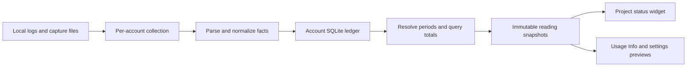

# AI Usage Trackers — technical reference

This describes implementation version **1.3.0**.
Source links identify the implementation; external links explain terminology and
provider contracts. Historical release notes describe earlier behavior, not
additional current features.

## Contents

1. [Goal](#1-goal)
2. [Architecture](#2-architecture)
3. [Definitions](#3-definitions)
4. [Runtime and build requirements](#4-runtime-and-build-requirements)
5. [Sources and collection](#5-sources-and-collection)
6. [Database and persistence](#6-database-and-persistence)
7. [Periods and token accounting](#7-periods-and-token-accounting)
8. [Requests, quotas, and estimates](#8-requests-quotas-and-estimates)
9. [Settings composition](#9-settings-composition)
10. [Widget and scrolling](#10-widget-and-scrolling)
11. [Portable configuration](#11-portable-configuration)
12. [Limitations and validation](#12-limitations-and-validation)
13. [Development history](#13-development-history)

## 1. Goal

Display locally recorded AI `usage` across projects in the IntelliJ IDEA status
bar, with configurable time periods, persistent history, and separately reported
`quota` information. Reading files must not invoke a `model`, require provider
credentials, or perform network collection. Missing or ambiguous evidence must
produce an explanation rather than fabricated precision or a destructive rebuild.

Collection and presentation are independent: all enabled, configured `accounts`
can collect while the widget displays one `vendor`, or rotates between vendors.
Shared source code uses the `local.aiusagetrackers` package. Legacy compatibility
identifiers are retained as described in section 4.

## 2. Architecture

The implementation is Kotlin on the IntelliJ Platform, using `Swing` for the UI,
`coroutines` for background work, and embedded `SQLite` for the `ledger`.



| Boundary | Implementation and responsibility |
| --- | --- |
| Shared application state | [UsageSettings.kt](src/main/kotlin/local/aiusagetrackers/UsageSettings.kt) persists settings and returns isolated copies. [UsageService.kt](src/main/kotlin/local/aiusagetrackers/UsageService.kt) owns monitors and published `snapshots` by `account`. |
| Collection | [CodexUsageCollector.kt](src/main/kotlin/local/aiusagetrackers/CodexUsageCollector.kt) preserves the Codex compatibility path. [ProviderUsageCollector.kt](src/main/kotlin/local/aiusagetrackers/ProviderUsageCollector.kt) handles other configured sources. |
| Adapter boundary | [UsageSource.kt](src/main/kotlin/local/aiusagetrackers/UsageSource.kt) normalizes one JSON object into `token` events and/or `quota observations`. Adapters perform no storage, network, or UI operations. |
| Storage and calculations | [UsageDatabase.kt](src/main/kotlin/local/aiusagetrackers/UsageDatabase.kt), [UsageAnalyticsStore.kt](src/main/kotlin/local/aiusagetrackers/UsageAnalyticsStore.kt), and [UsagePeriod.kt](src/main/kotlin/local/aiusagetrackers/UsagePeriod.kt) implement transactional imports, metadata, period resolution, and totals. |
| Presentation | [WidgetText.kt](src/main/kotlin/local/aiusagetrackers/WidgetText.kt) builds typed display values. [UsageWidget.kt](src/main/kotlin/local/aiusagetrackers/UsageWidget.kt) renders them per project; animation components do not query storage. |
| Configuration UI and transfer | [TrackerSettingsPanel.kt](src/main/kotlin/local/aiusagetrackers/TrackerSettingsPanel.kt) coordinates draft editors. [ConfigurationTransferService.kt](src/main/kotlin/local/aiusagetrackers/ConfigurationTransferService.kt) performs file work in the background and delivers results on the UI thread. |

Each collecting `account` has a monitor and coroutine lifetime. A monitor owns a
writer connection and a separate read-only connection. Scans are serialized per
monitor; a conflated request channel coalesces refresh requests. Filesystem reads,
parsing, database work, and real-data previews use `Dispatchers.IO`. Swing updates
run on the `EDT`. Cancellation propagates through parsing and transactions;
disposal closes connections, stops presentation timers, and releases the plugin's
JDBC driver registrations.

Both collectors sample the monitor's completion clock when recording a completed
scan. Collection timestamps and reset durations therefore use completion time,
including when a long scan crosses a quota reset.

| Schedule | Current implementation |
| --- | --- |
| Account configuration reconciliation | Every 250 ms; starts or cancels monitors as collection eligibility changes. |
| Collection | Initial scan, then every 30 s, plus **Refresh Now**. |
| Period evaluation | Every 250 ms against the current clock and zone provider. This handles date boundaries without waiting for a new log event. |
| Monitor recovery after storage failure | Retry after 5 s, retaining the last published reading with an error. |
| Project widget presentation | 250 ms Swing timer; renders cached state. |

New built-in providers extend the registry and capability policy rather than
loading arbitrary adapter code or using private IDE APIs. The admission checklist
is [adding-a-provider.txt](docs/adding-a-provider.txt).

## 3. Definitions

`USER-PASS` means the owner reports expected behavior while using the installed plugin in the IDE; it is separate from automated checks and controlled agent-run native acceptance (section 12.2).

These are project meanings where they narrow a broader industry term. Backticks
highlight domain terms and code identifiers; bold text identifies UI labels.

| Term | Meaning and reference |
| --- | --- |
| `agent` | Software that uses a `model` and tools to carry out a task with some independence. An agent may make several `requests`; it is not a subscription identity. The widget's **Agents** menu selects `vendors`, not individual running agents. [OpenAI agent guide](https://openai.com/business/guides-and-resources/a-practical-guide-to-building-ai-agents/). |
| `vendor` / `provider` | A source family represented by `UsageVendor`: Codex, experimental Claude, or experimental Antigravity. `ProviderProfile` is the implementation's local `account` configuration, not a claim that model name proves billing ownership. |
| `experimental support` | A theoretical implementation with passing synthetic tests but no real-subscription validation. Claude and Antigravity retain this status until contributors with subscriptions validate the scope in section 5. |
| `model` | The AI system processing input and producing output within a `request`. A selected model can affect how a commercial allowance is consumed. [Codex pricing and usage explanation](https://learn.chatgpt.com/docs/pricing). |
| `plan` | A provider subscription or commercial allowance arrangement. In code, `QuotaPlanProfile` means the manually selected `quota scheme`, not an authenticated marketing plan or an implementation work plan. See the same [pricing explanation](https://learn.chatgpt.com/docs/pricing). |
| `account` | An explicit local mapping of sources to an immutable ID, `vendor`, alias, and settings. It represents the user's intended subscription/account separation; checking source ownership does not sign in or verify billing entitlement. |
| `token` | A unit processed or generated by a model; it is not a word or currency amount. `Input`, `cached input`, `output`, and `reasoning output` are separate reported counters whose overlap depends on the adapter. [OpenAI token explanation](https://help.openai.com/en/articles/4936856-understanding-and-counting-tokens). |
| `usage` | Recorded token consumption. Period totals sum accepted timestamped events; they do not measure context occupancy, currency cost, or necessarily complete account-wide activity. |
| `request` / `response` | One reported model response, or a provider-specific finalized step/message accepted as a comparable event. It is smaller than a complete user turn, which may contain tools and several model responses. [Responses API](https://developers.openai.com/api/reference/resources/responses/methods/create). |
| `session` / `source` | A session is a logical history identified by metadata or accepted content. A source is a physical file or configured location. Copies of one session must not become additional consumption. |
| `quota` / `quota pool` | A reported allowance percentage and optional reset time for one independently limited pool. Pools may differ by duration or model. Pool names alone do not prove boundary rules. [Claude status-line fields](https://code.claude.com/docs/en/statusline), [Antigravity status line](https://antigravity.google/docs/cli/statusline/). |
| `quota scheme` / `capability` | Local policy describing which pool boundaries, percentage/reset displays, and estimates are supported for an `account`. A capability can exist while current data is unavailable. |
| `quota run` | Consecutive acquired reports for one pool with identical normalized quota facts. The ledger retains the run's first acquisition time; a value change, including a disabled/enabled transition, starts a new run. This does not establish provider freshness. |
| `observation` / `scope` | An observation is a timestamped report. A quota scope combines source, pool/bucket, and window duration so unrelated reports are selected separately rather than summed. |
| `capture` / `status line` | A capture is sanitized local output from the optional helper. A status line is a CLI callback that receives structured state and normally renders terminal text. Its invocation time need not be the provider's observation time. See the provider links above. |
| `tracker` / `period` | A named, account-bound total over one or more resolved time intervals. A period can be calendar-based, elapsed, or aligned with a provider reset. |
| `ledger` / `schema` | The durable database of accepted events and metadata, and its versioned table structure. The ledger survives removal of source files. |
| `snapshot` | A consistent reading of totals, metadata, and diagnostics at an evaluation time. The **Usage Info** window retains a captured reading until explicitly updated. |
| `estimate` / `pacing` | An estimate infers a token budget from local totals and observed percentage used. Pacing adjusts a color target according to reset progress; neither changes counted tokens. |
| `ribbon` / `carousel` | The inner ribbon displays a subset of one vendor's metrics. The outer carousel rotates complete vendor views, each with its own ribbon. |
| `SQLite`, `JDBC`, `WAL` | SQLite is the embedded database; JDBC is Java's database interface. Write-ahead logging allows readers and a writer to progress concurrently. [SQLite WAL documentation](https://sqlite.org/wal.html). |
| `EDT` | Swing's event dispatch thread, which handles UI work. Long collection and calculation tasks must stay off it. [IntelliJ threading model](https://plugins.jetbrains.com/docs/intellij/threading-model.html). |
| `coroutine` / `dispatcher` | A coroutine is suspendable work; its dispatcher selects the execution threads. `Dispatchers.IO` is used here for blocking file/database operations. [Kotlin coroutines](https://kotlinlang.org/docs/coroutines-basics.html). |
| `transaction` / `atomic` | A transaction commits related database changes together or rolls them back. Atomic file publication exposes a complete result instead of a partially written one; export and capture use different mechanisms described below. [SQLite transactions](https://sqlite.org/lang_transaction.html). |
| `cursor` / `digest` | Here, a cursor records the last completed source snapshot's file attributes. A digest is a content hash used to compare histories or name capture files; it is not encryption or proof of account ownership. |
| `JVM` / `JDK` / `SDK` | The Java virtual machine executes the plugin; the Java development kit builds JVM code; the software development kit supplies the target IntelliJ APIs. Required versions are in section 4. |
| `Swing` / `logical pixel` | Swing is the Java UI toolkit used for controls and timers. A logical pixel or font point is scaled through IntelliJ's UI scale and may occupy several physical screen pixels. |
| `API` / `CLI` / `callback` | An API is a programmatic interface; a CLI is a command-line interface. A callback is code invoked by another component, such as a provider's status-line command. |
| `Gson` / `SLF4J` | Gson parses/serializes JSON; SLF4J is a Java logging interface. The build uses platform-supplied facilities instead of bundling another SLF4J API alongside the database driver. |
| `BigDecimal` / `DECIMAL128` | Java decimal arithmetic and the selected 34-significant-digit calculation context. Integer totals stay separate from these rounded estimates. [Java decimal arithmetic](https://docs.oracle.com/en/java/javase/25/docs/api/java.base/java/math/BigDecimal.html). |
| `RGB` / `crossfade` | RGB expresses color through red, green, and blue channels. A crossfade blends opacity between two frames; it does not translate the content through space. |
| `UTC` / `epoch` / `clock` | UTC is the shared time reference; stored epoch seconds are measured from 1970-01-01T00:00:00Z. The injected wall clock determines event cutoffs; a monotonic nanosecond clock measures animation durations. |
| `JSONL` / `NDJSON` | UTF-8 JSON records separated by newlines. The adapters expect JSON objects, a narrower contract than general JSON Lines. [Format definition](https://jsonlines.org/). |
| `DST` / `zone` | Daylight-saving transitions and the time-zone rules used to convert local dates into instants. Calendar days can differ from 24 elapsed hours. [Java ZonedDateTime](https://docs.oracle.com/en/java/javase/25/docs/api/java.base/java/time/ZonedDateTime.html). |

## 4. Runtime and build requirements

Values below come from [build.gradle.kts](build.gradle.kts),
[the Gradle wrapper](gradle/wrapper/gradle-wrapper.properties), and
[plugin.xml](src/main/resources/META-INF/plugin.xml).

| Item | Value |
| --- | --- |
| Plugin name / ID | AI Usage Trackers / `local.codexusage.daily` |
| Vendor contact | `ai.usage.contributors@gmail.com` |
| Project / support | [Public repository](https://github.com/ai-usage-contributors/ai-usage-trackers) / [issues](https://github.com/ai-usage-contributors/ai-usage-trackers/issues) |
| Widget factory ID | `CodexDailyTokens` |
| Settings page / ID | **AI Usage Trackers** / `local.codexusage.daily.settings` |
| Gradle project / group | `ai-usage-trackers` / `local.aiusagetrackers` |
| Kotlin package | `local.aiusagetrackers` |
| Build/test SDK | IntelliJ IDEA `2026.3` |
| Development sandbox (`runIde`) | IntelliJ IDEA `2026.3`; retains its existing sandbox profile |
| Declared platform compatibility | Build `263` through `263.*` (IDEA 2026.3 only) |
| JVM toolchain | JDK `25` |
| Kotlin JVM / IntelliJ Platform Gradle plugin | `2.4.0` / `2.19.0` |
| Gradle wrapper | `9.5.0` |
| Optional archive signing | Marketplace ZIP Signer `0.1.45`, with Maven Central first and JetBrains' Maven cache as a fallback restricted to this module. Environment-based credentials and commands: [publishing](docs/publishing.md#signing-and-future-automation). Tool setup does not sign a release. |
| Bundled SQLite JDBC | `3.54.1.0`, excluding its SLF4J API dependency |
| Platform-supplied facilities | Gson, coroutines, logging, Swing, and IntelliJ APIs |
| Optional capture helper | Python `3.10+`; filesystem must support atomic hard-link publication |

The plugin logo uses the supplied Lucide-based chart drawing, packaged as
`META-INF/pluginIcon.svg` and `META-INF/pluginIcon_dark.svg`. Both SVGs are
40 x 40, with the original paths uniformly inset for at least 2px transparent
padding. Explicit blue strokes (`#3574F0` light, `#6EC5FF` dark) avoid relying on
inherited CSS colors. The ISC notice is bundled in `licenses/lucide-ISC.txt`.
See [JetBrains logo requirements](https://plugins.jetbrains.com/docs/intellij/plugin-icon-file.html).
The current plugin version is **1.3.0**.

The package includes third-party notices and capture resources, excluding helper
tests and Python cache files. Windows is the initial validation environment;
declared binary compatibility is distinct from OS-specific or live UI acceptance.

The product was renamed from Codex Daily Tokens in 0.18.3. The plugin ID,
configurable ID, widget IDs and persistent component name retain their legacy
values to preserve installation identity, settings and widget placement. Settings
and database paths remain as listed in section 6; the portable format marker
remains as listed in section 11. The dialog geometry keys `CodexUsage.Info` and
`CodexUsage.Disclaimers` also remain unchanged. Source package/class names are
independent of these contracts. Provider-specific Codex names and classes that
calculate a single day keep their descriptive names.

## 5. Sources and collection

**Claude and Antigravity support is experimental.** Their adapters and capture
paths are theoretically implemented from the documented contracts, and the
synthetic parser, collection, persistence, quota and presentation tests pass.
This demonstrates behavior against authored fixtures, not verified operation
with real subscriptions. The maintainer has no access to Claude or Antigravity
subscriptions. Contributors with access to the relevant subscriptions must test
actual client logs and capture setup, token totals and deduplication, quota/reset
observations against the provider's own usage display, and account isolation
before verified support can be claimed. Record the client version, subscription
and tested interface, redact any shared evidence, and distinguish observed passes
from remaining gaps. Subscription credentials must never be shared.

The experimental marker appears in vendor and account selectors, quota schemes,
widget prefixes (including custom prefixes), action menus and usage-info titles.
It is presentation metadata: serialized vendor identifiers, source contracts,
account bindings and quota capability gates retain their existing meanings.
See section 12 for additional coverage limits; synthetic UI demonstrations do
not count as subscriber validation.

### 5.1 Codex discovery

[CodexHomeDiscovery.kt](src/main/kotlin/local/aiusagetrackers/CodexHomeDiscovery.kt)
searches the user's `.codex` directory, `CODEX_HOME`, and configured extra homes.
On Windows it also searches JetBrains product directories under
`LOCALAPPDATA/JetBrains`, `APPDATA/JetBrains`, and the corresponding user-home
locations, appending `aia/codex`. macOS discovery uses
`~/Library/Caches/JetBrains`; unverified Linux IDE cache layouts require extra
homes. Paths are canonicalized to deduplicate overlapping roots.

Within each home, collection recursively visits `sessions` and
`archived_sessions` for `.jsonl` files across all dates and projects. A directory
date does not determine event ownership: an old session may contain today's
events. The original Codex `account` adds automatic discovery; additional Codex
accounts collect their explicitly configured homes.

### 5.2 Adapter contracts

| Adapter | Accepted facts and interpretation |
| --- | --- |
| [CodexSessionParser.kt](src/main/kotlin/local/aiusagetrackers/CodexSessionParser.kt) | Reads `event_msg` / `token_count`, preferring cumulative `total_token_usage` deltas and using `last_token_usage` as fallback. `session_meta` supplies identity and recognized fork markers. Request/quota parsing is separate. |
| [ClaudeUsageSource.kt](src/main/kotlin/local/aiusagetrackers/ClaudeUsageSource.kt) | Reads native `assistant` records with `message.id`, `message.usage`, and timestamp, including nested subagent files discovered beneath configured folders. Input is uncached input plus cache-read plus cache-creation input; output is added once. Identity is `message:<id>`. Sanitized envelopes supply optional quota reports. |
| [AntigravityUsageSource.kt](src/main/kotlin/local/aiusagetrackers/AntigravityUsageSource.kt) | Requires `usage-capture-v1` envelopes. Accepts `step_update` records only at `DONE`, keyed by conversation and step index. Requires input + output = total; cache/thinking counters are retained without adding them again. The timestamp is capture arrival time. Other supported envelopes carry generic quota pools. |

Non-Codex discovery accepts configured files or recursively scans folders for
`.jsonl`. A completed file snapshot is skipped while size and modification time
are unchanged. Facts and its file cursor commit together; a malformed, oversized,
conflicting, or changing import retains previous history and reports an issue.

Limits are implemented differently: Codex bounds each line to **4,194,304 Java
characters**, skips oversized/malformed records with diagnostics, and retries
unclean sources. Other adapters bound records to **1,048,576 Java characters**,
failing the file import on invalid input. They stream files without a whole-file
size cutoff, staging request revisions on disk and committing only the completed,
unchanged source snapshot. Character bounds are not UTF-8 byte bounds.

### 5.3 Optional capture helper

[capture.py](tools/quota-capture/capture.py) receives callback JSON or stream
records on standard input. It validates allowed field types, numeric ranges,
timestamps and identifiers before retaining quota fields or finalized step facts.
It wraps them with `vendor` and `captured_at` and writes one `.jsonl` file.
Input reads and sanitized output are bounded to 1 MiB per callback/stream record;
the stream reader limits allocation before accepting a line.

Publication writes and syncs a temporary file, then uses a hard link to publish
without overwriting a concurrent earlier capture. DONE steps use content identity
and retain their first capture time. Quota file identity also includes acquisition
time so available/disabled/value transitions remain ordered. Consecutive equal
quota values are coalesced when reading the ledger; a later return to an earlier
value starts a new run. Provider observation age remains unknown. Re-export the
helper after upgrading to apply the new capture behavior. The helper does not start an
agent, read authentication files, or access a network endpoint. Manual setup must
preserve any existing status renderer. The plugin exports helper files but does
not edit external provider configuration. Exact setup is in
[capture instructions](tools/quota-capture/README.txt).

### 5.4 Synthetic demonstration sources

The standalone [generator](tools/synthetic-usage/generate.py) requires only Python
3.10+. Its [JSON config](tools/synthetic-usage/config.json) sets per-vendor request
ages, input/output/cache/reasoning counters, quota percentages, report ages and
reset offsets. A single injected UTC `now` anchors every timestamp; the default
uses current time and an optional ISO timestamp makes generation reproducible.
Input includes cached input, and output includes reasoning; totals add input and
output once. Claude's raw input field subtracts cache before serialization so its
adapter adds it back once. Codex writes chronological cumulative reports paired
with explicit response records; Antigravity writes sanitized DONE captures.

Each run creates a fresh UUID dataset under `agent-logs/synthetic-usage`, or a
specified new output directory; existing destinations are refused. No IDE settings,
real logs, databases, vendor processes or credentials are accessed. Use separate
new demo accounts for each dataset because imported ledger history is retained.
The original Codex account's automatic discovery is unsuitable for isolated demos.
Quota capture preserves the limitations in section 5.2: Claude/Antigravity have
unknown provider observation time, and Antigravity pool names imply no verified
weekly boundary. This tool does not bypass capability or freshness checks.
Instructions and examples are in [README.txt](tools/synthetic-usage/README.txt).

Python tests compare deterministic output against the committed synthetic fixtures;
`SyntheticUsageGeneratorTest` imports those fixtures through the real Kotlin/database
paths and checks repeated import, interval boundaries, cached input and quota values.
The generator is a repository tool and is not bundled in the plugin distribution.
The synthetic generator does not change collection semantics.

## 6. Database and persistence

### 6.1 Location and ownership

`UsageConsent` stores agreement revision 1 in `aiUsageTrackersConsent.xml` with
`RoamingType.DISABLED`. Fresh installations and existing settings without this
revision require explicit agreement. Without saved agreement, the status bar shows
**Review usage agreement** even with no visible vendors. Clicking it opens General
settings, which contain the disclosure and Privacy Policy link. The widget checks
agreement during its 250 ms presentation refresh. General settings support granting
or withdrawing agreement on Apply/OK. Cancel and Reset discard draft changes.
Agreement is separate from `UsageSettings` and portable configuration.

Without agreement the service starts no account monitors and returns an
`agreement required` snapshot without cached usage. Preview database reads
and warning acknowledgements are gated too. Revocation hides readings immediately;
the 250 ms service loop cancels monitors and collection cancellation checkpoints
also check agreement. In-flight work stops cooperatively, retaining stored history.
Reaccepting starts eligible account monitors. Privacy links open a browser only
on explicit activation and do not grant agreement.

The [Privacy Policy](PRIVACY.md) describes local processing, retained data,
user-controlled exports, and deletion. The plugin and capture helper do not
transmit usage data to ai-usage-contributors or third-party servers.

The legacy Codex database remains at
`<IDE configuration directory>/codexUsage/usage.sqlite`. Additional databases use
`codexUsage/accounts/<vendor>-<local-account-id>.sqlite`. Project windows sharing
an IDE configuration share these application-level ledgers and settings.
`bindAccount` stores `vendor/id` ownership and rejects attaching another account
to that ledger. Aliases and source paths do not authenticate the mapping.

Settings persist in `codexDailyTokens.xml`. Only this settings component is
registered for IntelliJ settings persistence; usage databases are separate.
There is no automatic cross-installation history synchronization. Close the IDE
before copying, moving, or restoring the entire `codexUsage` directory, including
SQLite sidecar files.

### 6.2 Schema and transactions

Current database `schema` is **4**; Codex parser metadata version is **3**.

| Table | Purpose |
| --- | --- |
| `meta` | Scan timestamps/counts, operational/import diagnostics, analytic revision, ledger ownership, and page acknowledgements. |
| `sessions` | Accepted logical identity, digest, issues, and event count. Other adapters also use stable request/step keys here. |
| `sources` | Codex canonical path, file size/mtime/digest, associated session, parser version, issues, and accepted/provisional identity provenance. |
| `events` | Positive token increments keyed by session and sequence, with epoch seconds, nanoseconds, total, and history signature. |
| `analytics` | Request, activity, and quota records with identity, time, sanitized JSON payload, and conflict marker. |
| `provider_files` | Completed non-Codex file snapshot cursors: path, size, and modification time. |
| Temporary staging tables | `staged` for streamed increments, `staged_provider` for final request revisions and `staged_analytics` for metadata; scoped to the writer connection with file-backed temporary storage. |

Connections use a **2,000 ms** busy timeout and foreign keys. Writers enable
`journal_mode=WAL` and `synchronous=FULL`; readers enable `query_only` and require
the current schema. A read transaction keeps related totals and metadata
consistent while a writer imports. Analytics caching uses a transactional
revision and invalidates for clock rollback or future observation boundaries.

Only schema 4 is supported. Unsupported schemas, populated unrecognized databases,
and storage failures preserve files rather than silently rebuilding them.

### 6.3 Accepted history and identity

Codex import hashes raw content and chains normalized event signatures. It
accepts only an extension matching the already accepted prefix. Verified
identities and byte-identical accepted copies share history; truncation,
conflicting rewrites, changed source identity, and recognized forks cannot erase
or replace accepted events. Missing-identity histories with ambiguous overlap
remain provisional; remembering a rejected file does not prove its identity.

Removed files or configured homes never delete imported history. Clean Codex
sources are skipped only when metadata, parser version, identity, and stored
issues permit it. Unclean sources are retried. Parser-version changes can revisit
retained logs, but cannot backfill deleted ones.

Other adapters deduplicate stable message/step identities. A compatible revision
may replace one request's total rather than add a second request; incompatible
counter changes roll back the file import. Conflicting analytic identities are
marked and excluded by the analytics reader. Accepted facts contain counts,
identities, times, paths, and diagnostics; prompt/response bodies and credentials
are not copied into the ledger.

## 7. Periods and token accounting

### 7.1 Counting rules

Counters are nonnegative exact `Long` values. Codex validates input + output =
total, cached input ≤ input, and reasoning output ≤ output. Subset counters are
not added again. The first valid cumulative report starts from zero; later
reports contribute deltas. A decrease in any counter, or mixed fallback and
cumulative reporting, uses valid last-request usage if available and marks
coverage incomplete. Unchanged cumulative reports add zero.

Baselines are derived before filtering timestamps, so a session crossing
midnight contributes only its post-midnight increment to the new day. Events are
attributed to reporting time; a request spanning a boundary is not split into
token-level timing. Invalid timestamps are excluded, never replaced with file
modification time. Queries use `[start, end)` and exclude events after evaluation
time. Arithmetic or SQLite sum overflow makes the total unavailable with an issue.

### 7.2 Supported period definitions

| Type | Resolution |
| --- | --- |
| `Calendar periods` | Minute/hour/day/week/month boundaries in the selected zone; weeks start Monday, months on day 1. Amount N includes the current partial unit and N−1 preceding units by default. Disabling current period selects completed units. |
| `Elapsed duration` | Exactly N minutes, hours, 24-hour days, or 168-hour weeks. Ends at now or the selected calendar boundary, with an optional earlier-boundary offset. Elapsed months are rejected. |
| `Follow the weekly quota reset (all days)` | One current fixed weekly pool. Uses its selected observation and reset; see section 8.2. Zone affects displayed boundaries. |
| `Follow the five-hour quota reset` | One current five-hour quota window. Requires Amount 5, Unit Hours, and an account scheme with a fixed five-hour reset. Uses the selected five-hour observation; see section 8.2. Zone affects displayed boundaries. |
| Retained legacy schedules | Explicit endpoints, repeating anchors, and non-default daily windows remain readable and retain accounting. The editor locks schedule controls until **Use automatic periods** replaces them with calendar defaults. |

Calendar-day selection can use all days, Monday–Friday, or the latest N dates
with positive recorded usage. These resolve to disjoint daily intervals; excluded
days do not leak into the total. Provider weeks and quota calculations include
every day, including weekends and holidays. No holiday calendar is inferred.

**Also reset daily usage at weekly reset** is off by default and applies to
one current, automatic calendar day. It uses the tracker's account and
`quota pool`, with the same scope and resolved weekly boundary as the
provider week (section 8.2). If that instant falls inside the selected day,
it becomes the inclusive start while the calendar end stays in place. Day
selection, time zone and historical records are preserved. Without a usable
boundary, the tracker keeps its normal daily total and explains the fallback
in its period details. The saved choice is retained if the period changes.

A blank zone follows the system zone provider on each evaluation. Calendar
boundaries follow DST; Java local-time conversion shifts gap times forward and
chooses the earlier offset for overlaps. Minute/hour arithmetic follows the
timeline, while calendar day/week/month arithmetic follows dates. Collapsed or
inverted legacy windows become empty intervals with an explanation. Ambiguous
displayed minute/hour boundaries include offsets.

## 8. Requests, quotas, and estimates

### 8.1 Request evidence

[CodexAnalyticsParser.kt](src/main/kotlin/local/aiusagetrackers/CodexAnalyticsParser.kt) accepts
`token_usage_record` response identities and counters. Older `token_count`
reports establish a request only when every available last-usage counter matches
a clean cumulative increase. First snapshots, fallback-only usage, resets, and
quota-only repeats do not establish a new individual request.

Newer unverified activity qualifies the reading as **Last known request**;
timestamp ties disclose unknown order/overlap. Response metadata does not
silently rewrite the period ledger. Conflicts and unreconciled response versus
aggregate reports are diagnosed separately from ordinary freshness warnings.

### 8.2 Quota selection and freshness

[PlanCapabilities.kt](src/main/kotlin/local/aiusagetrackers/PlanCapabilities.kt)
defines Codex weekly-only/weekly-plus-five-hour schemes, experimental Claude
schemes, experimental Antigravity reported pools with unknown boundaries, and unverified
schemes. New Codex installations select weekly-only. Five-hour support is an
independent choice; it is not inferred from a weekly reading. Only Codex schemes
currently enable illustrative budget estimation.

Codex recognizes **10,080-minute** weekly and **300-minute** five-hour windows
regardless of primary/secondary placement. Claude captures normalize
`rate_limits.seven_day` and `rate_limits.five_hour`, their `used_percentage`, and
epoch-second `resets_at`. Antigravity captures normalize `remaining_fraction`
to a percentage and `reset_time` to an instant. A remaining amount without a
denominator, or relative reset seconds alone, cannot establish those values.
Disabled pools remain explicitly disabled. See
[ProviderQuotaReports.kt](src/main/kotlin/local/aiusagetrackers/ProviderQuotaReports.kt).

`QuotaPresentation` selects one eligible report per scope/window, newest first
with a stable scope tie-break. Pinned scopes and explicit tracker pool IDs do not
fall back to another pool when missing. Percentages are never summed across
sources; percentage/reset come from the same observation. Observations after the
completed collection/evaluation cutoff are excluded.

An observation is stale when over **15 minutes** old, or its provider observation
age is unknown. Callback acquisition time does not establish backend freshness;
repeated cached captures retain their earlier acquisition. At or after reset,
percentages and reset durations expire until a usable new report arrives.
**Refresh Now** rereads files, not a provider endpoint. The reset countdown is
sampled against stored scan metadata and remains fixed between collections;
evaluation ticks can expire it without inventing a fresh zero-percent balance.
The current scan-start timestamp discrepancy is recorded in section 12.1.

Provider-reset trackers use the selected account's quota observation with the
matching duration. A known previous reset can establish the start within the
window. Otherwise, the start is inferred as the reset minus 604,800 seconds
for a week or 18,000 seconds for five hours. At the reported reset, the next
tracker interval starts. Subsequent intervals are marked scheduled until a
fresh observation arrives, even while displayed quota readings are expired.
Missing selected observations make the tracker total unavailable.

### 8.3 Illustrative estimates and coloring

At a matching weekly or five-hour observation time, a positive local total `T` and reported
used percentage `p` in `[1, 100]` give `estimated budget = T × 100 / p` using
`BigDecimal` with `DECIMAL128` precision. Estimated remaining budget is
`budget × (100 − p) / 100`. Used display pairs the observed used percentage with
the observed local tokens; remaining display uses estimated remaining tokens.
Five-hour estimates count events from the previous reset if it falls inside
the current window, or from the reported reset minus five hours. The start
and observation instant are included. A missing boundary, disabled pool, or
observation outside the five-hour window prevents an estimate. After reset,
the previous estimate expires. Each quota window has its own estimate toggle
and used/remaining selection. Upgraded profiles initially inherit the former
shared percentage mode for the five-hour window.
These are not fixed provider token allowances or predictions for another model.
An unexplained percentage decrease within the same reset window invalidates
the estimate. Rounded percentages, missing sources, and changing model/mode mix
can bias it.

Token metrics divide the tracker or request total by the full estimated budget.
Five-hour shares apply to eligible trackers set to 1–5 hours or 1–299 minutes,
including provider reset-aligned five-hour trackers, and to Last request. The entire selected period
supplies the numerator, including when it crosses a reset. Eligible displays
use a dash for an unavailable estimate. Each tracker and Last request can
reorder and prefix its token count, weekly share, and five-hour share, for
example `2h: 5h 40.7%|Tokens 2.5M|Week 0.7%`. When the five-hour share is
ineligible, the order choices and prefix field omit it. The share control
explains the applicable period or quota scheme requirement. Its saved prefix and
position are restored when eligibility returns. Shares always represent usage,
regardless of the reported quota's display mode. Color targets are presentation
policy, not usage filters:

| Tracker unit | Target share of weekly budget |
| --- | --- |
| Minutes | `amount × 2.5% / 60` |
| Hours, up to 168 | `amount × 2.5%` |
| Days, up to 7 | `amount × 20%` |
| One week | `100%` |

Targets cap at 100%; displayed totals and percentages do not. Months,
multi-week, explicit, and repeating periods have no quota-goal target. With
weekly pacing enabled for the current provider week,
`allowance days = clamp(7 − whole 24-hour days remaining, 1, 7)` and the target is
`budget × allowance days / 7`. One day is allowed immediately after reset; the
second begins with less than six days remaining.

`Five-hour tracker colors` is enabled by default. With widget coloring and
`Color by quota goal` enabled for an eligible tracker, the five-hour segment uses its own goal of
`100% × tracker minutes / 300`. A two-hour tracker reaches this goal at 40%
of the estimated five-hour budget. The segment includes its text prefix and
keeps its color through metric reordering and visible ribbon clipping. A
missing estimate uses the neutral color. Turning the option off makes this
segment use the tracker value's shared color. Disabling `Color by quota goal`
uses the neutral color for the entire tracker. Last request has no duration-based goal.

The shared palette defaults to theme-neutral, green `#00FF00`, yellow `#FFFF00`,
orange `#FFA500`, and red `#FF0000`. RGB channels interpolate at usage/goal
multiples 0, 1, above-goal, and warning; defaults are 2 and 3 for the last two.
Decimal multipliers must satisfy `1 < above < warning`, with at most nine digits
per integer/fractional part. Ratios beyond warning stay red. Missing targets use
neutral. Metric dividers, tracker period boundaries, and clipping marks use
the neutral palette color. Labels keep theme coloring, and the operational
warning icon is independent.

Weekly quota coloring is opt-in. Used mode uses `used / 100`; remaining mode
uses the equivalent depletion ratio `used / 100 × warning multiplier`, making
full remaining green and none remaining warning-colored. Standalone five-hour
quota uses `goal = 20% × max(1, 5 − whole hours remaining)` during its reported
five-hour reset window. The goal starts at 20% and advances immediately after
each whole-hour boundary, matching weekly pacing's boundary rule. The same
palette maps `reported percent used / goal` in Used and Remaining display
modes. In hour one, 20% reaches At goal, 40% reaches Above goal, and 60% reaches
Warning with the default multipliers. A missing or expired reset uses neutral.
Disabling the coloring master uses theme text
colors without clearing saved choices. Legacy threshold styles remain readable,
but current shared presentation discards their colors while retaining hidden labels.

## 9. Settings composition

General begins with the local processing agreement and Privacy Policy link. Both
controls and their labels provide hover help and accessible descriptions.

### 9.1 Shared layout and draft behavior

**Settings > Tools > AI Usage Trackers** contains six tabs and one shared bottom
preview. The tab bar stays visible while tab content scrolls: the configurable
implements `Configurable.NoScroll` to prevent an outer IDE scroll pane. Each tab
has its own vertical scroll viewport; content follows viewport
width, focus scrolls controls into view, and the unit scroll increment is 24
logical pixels. Full-width bordered categories have bold titles, collapse
toggles, and a borderless context-help icon. **Period details** starts collapsed;
other categories start expanded. Expansion is retained while Settings is open.

The help icon toggles a third column: label, control, explanation. Nested
categories have independent help scope. Labels and nested editable controls
receive hover text and accessible descriptions. Hover text is reduced to its
first sentence; row help retains detailed explanations and vendor path examples.

Inapplicable rows hide together with labels/help, retaining draft values. Empty
categories hide; validation still checks retained values and reveals the relevant
tab/category/control on error. A missing tracker selection shows an instruction
instead of an inactive editor. Settings save through **Apply/OK** and discard
drafts on **Cancel**, with the local preview-pin exception below.

### 9.2 Tab inventory

| Tab / categories | Elements and composition |
| --- | --- |
| **General — Displayed usage** | **Displayed vendor**, **Multi-vendor carousel**, vendor inclusion boxes, motion mode, speed, independent horizontal/vertical intervals, and vertical direction. |
| **General — Vendor tracking and widget prefix** | **Configure vendor**, **Track usage**, **Widget prefix**, and **Advanced…**, which opens the same vendor's account/source setup. Editing a vendor is independent of selecting the displayed vendor. |
| **Trackers — list/editor** | Top toolbar: **Add New**, **Remove**, **Move Up**, **Move Down**, **Duplicate**, and **Sort Trackers** with shortest-first and longest-first choices. Drag handles support reorder. A draggable gray splitter separates the list from the editor. |
| **Trackers — Period** | Name; explicit account/token dataset and editable quota-pool selector; amount; unit with equivalence-info button; period type; day selection; current-period inclusion; optional weekly reset alignment for one current calendar day; visibility; minute/hour boundary display; time zone; elapsed ending boundary/offset. Legacy schedule summary/conversion appears where applicable. |
| **Trackers — Status bar / Period details** | Automatic/Fixed/Ribbon placement, hide label, optional weekly and eligible five-hour shares, metric order, and per-metric prefixes. Period details shows background-resolved intervals and totals, up to 20 intervals in long descriptions. |
| **Trackers — Last request** | Visibility, label, hide label, weekly and five-hour shares, metric order, and per-metric prefixes. |
| **Quota — account and plan capabilities** | **Quota account**, vendor-specific **Account quota limits**, and display of limits with an unverified reset schedule. Switching accounts preserves each account's drafts. |
| **Quota — weekly / five-hour** | Independent percentage visibility, text/hide-label controls, reset visibility/label controls, newest-or-pinned source selectors, and availability warning icons. Unsupported capabilities disable controls; temporary missing/stale data does not erase choices. |
| **Quota — percentage display / token budget estimate** | Independent used/remaining selectors and opt-in illustrative weekly and five-hour budgets. Other reported pools use the weekly selector. |
| **Appearance — Status bar layout / Ribbon** | Auxiliary metric pinning, observed average/max entry width, configured ribbon width, automatic widening, scroll mode, relevant speed or interval/direction controls, and bulk token percentage display. |
| **Appearance — Font / Date and time** | IDE-default or custom font, 8–24 logical-point size, editable date preset/custom pattern, 12/24-hour format, and format sample. |
| **Appearance — Coloring** | Master switch, weekly quota colors and pacing, separate five-hour tracker colors, eligible tracker goal switches, five palette colors, decimal breakpoints, gradient samples, and palette reset. |
| **Sources — Additional Codex folders** | Multiline extra homes for the original Codex account, alongside automatic discovery. |
| **Advanced — Accounts and usage sources** | Vendor, account to edit/display, **Add account**, **Remove account**, alias, vendor-specific source paths with folder/file pickers, capture folder with browse, ownership confirmation, configuration status, default-tracker creation, setup instructions, and helper export to an empty folder. Removal requires reassigning/removing bound trackers and preserves the ledger; the original Codex and last account per vendor are protected. Add is disabled at 32 profiles. |
| **Advanced — Tracker limit** | Maximum tracker count. Existing larger lists raise the initial limit to preserve them; lowering it never deletes trackers automatically. |
| **Advanced — Settings transfer** | Export the selected tracker or all tracker definitions and optional appearance, vendor labels, and carousel settings. Import previews the file and maps accounts before applying to the draft. |

Duration sorting includes hidden trackers and keeps the selected tracker and
the relative order of ties. It uses configured amounts with nominal 24-hour
days, seven-day weeks, and 30-day months. Legacy explicit periods use the
duration between their resolved endpoints.

Provider-reset modes hide amount/unit, day-selection, current-period, and elapsed
controls while retaining zone display settings. Five-hour alignment also keeps
the option to show hour boundaries. Custom font/color subordinate
controls and ribbon mode-specific timing rows appear only when applicable.
No editable custom reset, explicit-date, or repeating-anchor controls are offered
for new schedules.

### 9.3 Defaults, limits, and previews

| Setting | Default / accepted range |
| --- | --- |
| Starter trackers | **Today**, **This week**; visible, calendar, amount 1, all days, include current, system zone. |
| Tracker limit / amount / end offset | 5, configurable 1–32 / 1–1000 / 0–1000. |
| Accounts | At most 32 distinct local profiles; IDs match `[A-Za-z0-9_-]{1,80}`. |
| Account aliases / widget prefixes / quota labels | Alias and labels 1–80 printable characters; prefix may be blank to use vendor name. Prefixes cannot begin with `<html>` (case-insensitive, after trimming). Existing saved values with that marker are quoted in menus; dynamic labels and metric tooltips render literal text. |
| Collection | Codex enabled; other vendors disabled. Original Codex source mapping starts confirmed. |
| Optional metrics | Last request, quota percentages/resets, estimated budgets, and token shares off. Metric order defaults to tokens, weekly share, five-hour share, with blank prefixes. |
| Appearance | IDE font; `yyyy-MM-dd`; 24-hour clock; coloring enabled, weekly quota colors/pacing off. Date patterns are 1–80 characters and must produce readable output. |
| Inner ribbon | Width 280 logical px (80–1200), speed 30 logical px/s (0–200), Restart, step intervals 3 s each (0–300), Up, automatic widening off. |
| Outer carousel | Off; Vertical step, Up, intervals 8 s each (0–300), speed 30 (0–200). |

**Add New** asks for amount/unit. When all amounts are one, no explicit ranges
exist, and units already ascend or descend, insertion follows that direction;
otherwise it appends. Duplicate stays beside its original; editing does not
auto-reorder. Unit-equivalence hints are informational, not automatic conversion.

The sample widget preview is horizontally scrollable and timer-free, with UTC
sample totals/unavailable/loading states. Dragging visible tracker segments edits
the same draft order as the list while preserving hidden slots. Quota preview
adds collected, stale, and expired states; synthetic values do not change data.
An optional 0–168 **Hours until reset** sample supports weekly pacing previews.
Real period-preview refresh is debounced **350 ms**; quota availability UI checks
run every **1 s** while shown.

**Pin preview** moves the single preview between the active tab's footer and a
reserved bottom dock. This preference saves immediately, survives **Cancel**,
and is excluded from portable exports. See
[SettingsLayout.kt](src/main/kotlin/local/aiusagetrackers/SettingsLayout.kt) and
[TrackerWidgetPreview.kt](src/main/kotlin/local/aiusagetrackers/TrackerWidgetPreview.kt).

## 10. Widget and scrolling

### 10.1 Elements and formatting

Each vendor panel consists of a prefix/actions button, fixed metric buttons,
inner ribbon, and a single Info/warning toggle. Metrics are separated by `·`.
Automatic placement fixes amount-one week/day/hour trackers, regardless of name;
Fixed/Ribbon overrides this. Auxiliary request/quota/reset metrics can be pinned
independently. Fixed tracker values keep configured relative order. IntelliJ
owns placement of the complete status widget; ribbon left-button gestures opt
out of IDE glass-pane reordering through the public `TopComponent` API.

Counts use K/M/B suffixes and at most one decimal, half-up rounded with trailing
zeros removed. Usage Info shows exact integer counts plus millions to two
decimals. Quota percentage and optional estimated tokens use a compact separator,
for example `80%|~281.8M`, without a trailing word “tokens.” Minute/hour trackers
can show resolved start/end, with `now`, dates, and offsets as needed. Labels may
be hidden visually while accessible text retains metric identity. Loading,
unavailable, stale, expired, and no-visible-tracker states are distinct.

The actions menu contains **Agents**, **Refresh Now**, **Settings**, and
**Disclaimers**, plus applicable ribbon-resize actions. Normal Agents selection
is shared across project windows; in carousel mode it becomes an inclusion list
and prevents removing the last visible vendor. No eligible vendors produces
**No vendors enabled — Settings**. Disabling collection retains saved history.

### 10.2 Inner ribbon motion and input

| Mode | Behavior |
| --- | --- |
| Restart | Move to the rightmost offset, pause 1 s, then restart at the beginning. |
| Bounce | Reverse at either endpoint after a 1 s pause. |
| Continuous | Render a duplicate sequence and wrap offsets to join tail and head without an endpoint pause. |
| Horizontal step | Advance to offsets aligning the next entry's right edge with the viewport right edge. Partial entries at the left are allowed; wrap after the last offset. |
| Vertical step | Advance the starting entry by one, pack complete consecutive entries that fit, and center a singleton. Up follows configured order; Down reverses it and the chooser traversal. |

Both step modes use a **160 ms crossfade**, not vertical/horizontal pixel
translation. Opacity follows smoothstep `t²(3−2t)`. The Swing animation timer is
**25 ms**; rendering latency is not a guaranteed frame rate. The outgoing frame
is captured so rapid manual input can blend from the current image. Value refresh,
repacking, timing/mode changes, chooser activity, and disposal discard stale
transition frames. Chooser selection is immediate.

Hover, focus, dragging, open menus/popups, and outer transitions pause automatic
motion. Pixel modes use speed; step modes use their independent intervals. Zero
disables automatic motion for the relevant mode without preventing manual input.
All-fit content stays stationary. Elapsed pixel motion is clamped to **100 ms**
per tick after a stall; step scheduling advances once and starts a new interval,
without catch-up bursts.

Wheel/trackpad input uses precise rotation. Pixel modes move **30 scaled pixels
per wheel unit**; step modes accumulate fractional rotation until a whole step.
Left dragging starts at **3 scaled pixels**; step-mode drag accumulates
**30 scaled pixels per step**, using the vertical axis in Vertical step.
Manual navigation pauses pixel motion for **2 s** and step motion for at least
**2 s and one full configured interval**. Stable metric IDs preserve the selected
entry where possible across updates.

Vertical hover opens a chooser above the ribbon with remaining entries, packed
by measured width. Shared rows contain individually selectable buttons; limited
screen height adds vertical scrolling. Hover does not steal editor focus.
**Alt+Down** opens from focused ribbon; arrows navigate, Enter selects, Escape
dismisses. A **50 ms** monitor uses a **200 ms** pointer-transfer grace period
between ribbon and popup. If an AWT pointer query throws an
`ArrayIndexOutOfBoundsException` during a display change, `WidgetPointer` reports
an unavailable reading. Automatic ribbon/carousel advancement pauses; existing
transitions may finish. No hover-open/hover-end callback is issued from an unavailable
ribbon reading. The popup stays open unless a reliable outside reading lasts the full
**200 ms** grace period; unavailable readings reset that deadline. Queries retry on
the existing **25 ms** animation and **50 ms** popup ticks without repeated error logs.
Keyboard agent navigation requires confirmed hover or widget focus; unavailable
pointer information alone never claims IDE shortcuts. Normal presentation refresh
and explicit navigation remain available. Other exceptions are not swallowed.
Owner-reported local testing verifies the fix; controlled monitor variants remain
unexecuted. See N10 in the
[testing record](docs/native-ui-testing.txt).

### 10.3 Automatic width and notices

With automatic widening enabled, requested ribbon width grows to fit the widest
rendered entry, including off-screen entries, with scrollbar reserve for the
chooser. It may exceed the configured 1200-pixel limit; the IDE still controls
physical space. The configured base width is not mutated. Expanded width is
retained for that widget lifetime even after values shorten.

A resize popup offers **Acknowledge** to retain width/option and clear its notice,
or **Revert** to restore configured width and persistently disable widening.
Dismissal keeps the notice. The shared warning button and **Review ribbon
resizing** reopen it; a later larger width creates another notice. Resize notices
are separate from persisted usage/source acknowledgements.

Average/max statistics sample each distinct dynamic ribbon entry per changed
render set, excluding the continuous duplicate. Width includes button insets,
excludes inter-entry separators, and reflects observed IDE scale. Maximum stores
the full value text. Statistics persist locally across restarts and settings
updates and are excluded from portable configuration.

### 10.4 Outer vendor carousel

[VendorCarousel.kt](src/main/kotlin/local/aiusagetrackers/VendorCarousel.kt)
rotates complete panels. It has independent motion settings and no outer-width
control; preferred dimensions use the largest member view. Membership affects
display, not collection, and turning the carousel off restores remembered
single-vendor selection. One included vendor stays stationary.

Outer stepped transitions **slide for 160 ms**. Smooth modes dwell **2 s** when
speed is nonzero, then slide for `max(160 ms, width / speed seconds)`. Unlike the
inner ribbon, smooth-mode speed controls transition duration rather than dwell.
Restart's last-to-first wrap has no outgoing transition; Bounce reverses member
order at endpoints. A **25 ms** timer drives motion; hover, focus, menus, open
Info/resize/chooser popups, and an active transition pause advancement.
**Alt+Left/Right** navigates manually while the widget is hovered or contains
focus, within its focused IDE window and with no menu or widget popup open.
A lifecycle-scoped key dispatcher consumes the arrow press/release and the
following Alt release without requesting focus from the editor. It is removed
when the carousel is detached or disposed, so replacing the vendor panel does
not remove shortcut handling.
Wheel input over the agent label accumulates precise rotation into whole agent
steps, discarding the remainder on direction reversal. Left dragging the label
starts at **3 scaled pixels** and commits **one agent step per 30 scaled pixels**
on release, suppressing the action menu for drags. Vertical step uses vertical
drag distance; other modes use horizontal distance. These gestures cycle only
carousel members and are stationary with one member. A plain label click opens
the actions menu. Label and ribbon gesture surfaces exclude wheel and left-button
events from glass-pane preprocessing; ribbon gestures continue to affect only
the current agent's entries.
Actual incoming panel bounds move with its
pixels, preserving alignment of hit targets. Inner motion is paused during outer
transitions.

### 10.5 Detail pages and acknowledgements

**Usage Info** is a resizable, movable reading window with minimum size
**560 × 240 logical pixels** and remembered dimensions. It stays open on outside
clicks and window deactivation. Close, Escape, the info toggle, or widget disposal
can dismiss it. Its account context is captured when opened, so rotation does not
replace it with another account.

**Usage** shows exact totals, period boundaries, request/quota details, timestamps,
coverage counts, earliest recorded usage, and database location. **Warnings**
contains operational/availability/estimate findings; **Log Integrity** contains
parser, identity, source-import, and conflicting-history findings. Classification
comes from data provenance rather than matching warning text. Log integrity
findings do not directly populate the shared operational-warning indicator.

**Update View** recaptures all three pages together; **Copy Page** copies only the
selected page. Background collection does not replace the open reading. A
completed collection timestamp records a finished scan even with findings;
warning-free collection additionally requires no current or retained source/session
issues. Cancellation does not record a completed scan.

**Acknowledge Page** appears only for outstanding Warnings/Log Integrity findings,
disables during saving, and hides after success. Acknowledgement is per complete
message and page, persists in `meta`, and leaves an `[Acknowledged]` label. Repeated
identical messages stay acknowledged; changed messages need review. Saving does
not repair logs, change totals, or certify successful collection. An asynchronous
save cannot acknowledge a subsequently refreshed reading. The warning triangle
uses fixed `#FFB86C`, independent of quota colors; a pending resize notice takes
priority when clicking that shared button.

## 11. Portable configuration

[TrackerConfigurationJson.kt](src/main/kotlin/local/aiusagetrackers/TrackerConfigurationJson.kt)
uses UTF-8 JSON with format identifier `codex-usage-trackers`. The configuration
format version is independent of plugin, database, and parser versions.
The suggested filename is `ai-usage-trackers.json`. Imports accept formats v11
through v15. Exports use v15 for provider reset-aligned five-hour trackers.
Exports use v14 when included appearance settings turn off separate five-hour
tracker coloring, or v13 when a tracker enables five-hour shares or customizes
metric order or prefixes. Otherwise, exports use v12 for daily weekly reset
alignment, or v11 for the remaining settings. Older formats load with defaults for
settings they do not contain. Account-specific quota and Last request options are
stored in local settings.

Exports contain tracker definitions and optional appearance/General display
preferences. Portable files store logical vendor/alias bindings and quota-pool IDs, not
database account identities. Import explicitly maps bindings to local accounts
or leaves them unresolved; a missing pool stays unavailable. Optional General import cannot enable collection or install
callbacks.

History, reports, source paths, credentials, tracking switches, ownership
confirmation, plan/quota preferences, tracker limit, Last request visibility/labels,
preview pinning, and width statistics are excluded. Merge appends in file order;
Replace substitutes the draft list. Imported trackers receive fresh internal IDs.
Cancel discards the imported draft; no token history is imported or deleted.

Validation bounds files to **1 MiB**, trackers/array entries to **32**, nesting to
**12**, tracker names to **256 characters**, field names to **128**, and strings
to **4096**. Invalid UTF-8, unknown fields/enums/versions, duplicate keys, nulls,
comments, trailing content, and mistyped values are rejected. Numeric JSON values
must be integers; decimal multiplier values are encoded as strings. Draft tracker
limits also apply before acceptance. Export writes a sibling temporary file and
uses atomic replacement; lack of atomic-move support fails rather than writing a
partial destination.

## 12. Limitations and validation

The local-processing agreement candidate has 260 passing automated tests, clean
changed-file IntelliJ inspections, successful packaging/configuration checks and
IDEA 2026.3 compatibility verification. Its signed ZIP passed signature verification.
The owner reports local installed-plugin testing and marks the agreement flow
USER-TESTED on 2026-11-16; see [the acceptance record](docs/native-ui-testing.txt).
This records owner functional acceptance separately from controlled agent execution;
exact installed-artifact identity and individual subvariants were not independently verified.

### 12.1 Coverage and interpretation

- Local sources establish local recorded consumption, not authenticated,
  account-wide billing totals. Source ownership confirmation is user-supplied.
  Separate account configurations do not prevent the user mapping the same
  physical history to two different ledgers.
- Codex CLI/JetBrains activity counts where supported local session logs exist.
  Same-CLI terminal use can share sources after verifying the effective home.
  Desktop-only, remote/cloud, Air chat/ACP, and JetBrains AI billing coverage need
  separate evidence. macOS discovery exists but is unvalidated; Linux IDE paths
  are explicit rather than guessed.
- Experimental Antigravity token support is limited to captured headless DONE steps. Raw native
  transcripts and interactive/desktop/ACP token traffic are unverified; captured
  completion time has arrival-time precision. Generic quota pools do not enable
  fixed-week calculations until their boundaries are verified.
- Logs removed before import cannot be recovered. Stored zero does not certify
  historical completeness. Recognized Codex forks are excluded, not generally
  deduplicated. Previously incorrect history accepted by 0.2.0 is not
  automatically identifiable or repaired.
- Size/mtime-based skipping assumes a source changes one of those attributes.
  There is no independent provider poll or guarantee of live quota. A configured
  scheme proves neither data freshness nor complete client coverage.
- Performance timings, physical wake/resume latency, native device gestures,
  layout/scaling/theme appearance, and live provider balances cannot be proven
  by synthetic headless tests alone.

### 12.2 Development checks and evidence

The signed **1.3.0** candidate passed **283 Gradle tests**, packaging,
configuration verification, and Plugin Verifier 1.411 on IDEA **2026.3**
(build **263.7307.200**). ZIP Signer verified the signature. See the
[testing record](docs/native-ui-testing.txt) for archive hashes and pending native acceptance.

The signed **1.2.0** candidate passed **283 Gradle tests**, packaging, and
configuration verification. IntelliJ and SonarQube reported no findings for the
consent changes. Plugin Verifier 1.411 reported compatibility with IDEA **2026.3**,
build **263.7307.200**. The testing record identifies the signed archive and
tracks native acceptance and the Marketplace install check.

The UI defect fixes passed 256 Gradle tests, packaging/configuration, IDEA 2026.3 compatibility verification and changed-file IntelliJ inspections. Native retests verified readable foregrounds across both theme directions and hover shortcut isolation from the focused Project pane. See R2 in the acceptance record for candidate identity and evidence. Plugin Verifier 1.411 is explicitly declared for the build check.

The maintained native acceptance plan is [docs/native-ui-test-plan.txt](docs/native-ui-test-plan.txt).
The [Given/When/Then testing record](docs/native-ui-testing.txt) identifies the
plugin and IDE versions for historical observations and keeps current-candidate
expectations separate. R1 records partial agent-run IDEA 2026.3 results and two reproduced defects; R2 records successful targeted native retests after their fixes. U1 records the owner's installed-plugin testing as `USER-PASS` for all other 43 scenarios, separately from automated and controlled native checks. Independent screen-reader verification remains blocked.
Update both documents for every release; see AGENTS.md. The older local coverage
report below remains the provenance for historical observations, not a pass for
the current candidate.

Experimental-vendor labelling on 2026-11-16 passed all **255 Gradle tests**,
**8 capture-helper tests** and **6 generator tests**, packaging, configuration
checks and Plugin Verifier for IDEA **2026.3**, build **263.7307.200**. IntelliJ
inspections of the 11 changed supported source/descriptor files reported no
findings. The existing settings XML round-trip test passes with persisted enum
strings unchanged; only UI rendering adds the experimental labels. Package
integrity checks confirm version **1.0.0** and matching helper resources.
Evidence: `agent-logs/experimental-vendors-final-validation.log`,
`agent-logs/experimental-vendors-python-capture.log`,
`agent-logs/experimental-vendors-python-generator.log` and
`agent-logs/experimental-vendors-package-integrity.log`. No real-subscription,
native/live-plugin or performance testing was performed. Subscriber validation
in section 5 remains necessary before verified vendor support can be claimed.

Review remediation on 2026-11-13 passed all **255 Gradle tests**, **8 capture-helper
tests** and **6 generator tests**. The final 1.0.0 archive passed `buildPlugin`,
`verifyPluginConfiguration`, and `verifyPlugin` against IDEA **2026.3**, build
**263.7307.200**. IntelliJ inspections of all 15 source/test files changed by this
task reported no findings. ZIP/JAR integrity checks passed, and the packaged helper
and instructions match their sources. Evidence:
`agent-logs/project-review-final-artifact-validation.log`,
`agent-logs/project-review-python-capture.log`,
`agent-logs/project-review-python-generator.log`, and
`agent-logs/project-review-package-integrity.log`. No native/live-plugin or
performance testing was performed for these fixes.

Earlier synthetic generator validation on 2026-11-13 passed six Python tests and all
245 Gradle tests, including fixture imports through all three real vendor paths.
`buildPlugin`, `verifyPluginConfiguration` and `verifyPlugin` succeeded; the
unchanged plugin artifact reused its up-to-date three-target compatibility result.
IntelliJ inspections of the generator, Python tests, config, Kotlin test and CI
workflow reported no findings. Evidence: `agent-logs/synthetic-generator-python-tests.log`
and `agent-logs/synthetic-generator-gradle-validation.log`. No native/UI or
performance testing was performed for this standalone tool.
The earlier **1.0.0** contact/logo package passed all **244** ordinary Gradle tests,
`buildPlugin`, `verifyPluginConfiguration`, and Plugin Verifier on all three IDEA
targets on 2026-11-13. IntelliJ inspections of the build script, descriptor and
both SVGs reported no findings. The packaged descriptor contains the requested
version and email; both icon variants and the ISC license match their source
resources. Offline rendering verified both variants at 40px and 80px on light
and dark backgrounds. No native/live-plugin or performance tests ran for this
metadata-only change. Evidence: `agent-logs/marketplace-icon-contact-1.0.0-validation.log`.
Historical version **1.0.1** metadata validation passed on 2026-11-13: all **244** Gradle
tests, `buildPlugin`, `verifyPluginConfiguration`, and Plugin Verifier for IDEA
2026.2.3, 2026.2.4 and installed build 263.7307.200. IntelliJ inspections of the
changed build script and plugin XML reported no findings. Evidence:
`agent-logs/marketplace-metadata-1.0.1-validation.log`.

Native UI testing of **1.0.0** on Windows in the IDEA 2026.2.3 sandbox is
**partial**. The [native UI coverage report](plans/results/native-ui-test-coverage-1.0.0.txt)
consolidates observed widget/settings, configuration transfer, clipboard and
synthetic two-vendor carousel passes, evidence limitations, and remaining local
checks. It supersedes older deferred-native checklists only for scenarios it
explicitly covers; it does not establish accessibility, a full theme/scaling
matrix, controlled quota states, or every ribbon/lifecycle scenario.

GitHub CI runs helper tests, Gradle tests, packaging, configuration and compatibility
verification on every push and pull request, with a manual trigger. It uses Windows,
JDK 25 and Python 3.13. Reports and successful packages are retained for 14 days.
Hosted execution remains unverified until the first GitHub run. CI does not publish
or replace required IntelliJ inspections. See [publishing preparation](docs/publishing.md).

For 0.18.5, all 248 Gradle tests, packaging/configuration checks and compatibility
verification passed (all three configured IDEA targets Compatible). Changed Kotlin
and build files passed IntelliJ inspections. Final package contents match the
verified artifact. Evidence: local `agent-logs/sonar-*` files. The user limited
final Sonar assessment to findings newly introduced during this session; older
cached records are excluded. No native/UI or performance testing was performed.

For 0.18.4, 248 Gradle tests passed with zero failures/errors; final packaging,
configuration verification and compatibility verification passed. Both configured
IDEA targets were Compatible. IntelliJ inspections of the changed build script and
workflow reported no findings on the final check. LICENSE was verified inside the
packaged JAR. Evidence is in local `agent-logs/github-*` files. After Python was
installed, all four helper tests passed locally on Python 3.15.2. The workflow's
Python 3.13 execution remains pending with the first hosted CI run. No native/UI
or performance testing was performed.

From the repository root on Windows:

```powershell
.\gradlew.bat test
.\gradlew.bat buildPlugin
.\gradlew.bat verifyPluginConfiguration
.\gradlew.bat verifyPlugin
```

`verifyPlugin` targets IDEA 2026.3 only. Add
`-PverificationIdePath="<installed IDE directory>"` to verify an installed 2026.3 IDE instead of downloading it.
`runIde` delegates to `runIde20263` and forwards `--args`. It launches IDEA
2026.3 in `.intellijPlatform/sandbox/ai-usage-trackers/IU-2026.3`, with its own
configuration, system, plugin and log directories. Use
`-PrunIdePath="<installed IDEA 2026.3 directory>"` to use a local installation;
this property also selects the local 2026.3 build/test SDK. Otherwise Gradle
resolves IDEA 2026.3. This runtime selection uses the
[IntelliJ Platform testing extension](https://plugins.jetbrains.com/docs/intellij/tools-intellij-platform-gradle-plugin-testing-extension.html).
To retain an existing 2026.2.3 sandbox's plugin settings, close that sandbox and
copy `config_runIde/options/codexDailyTokens.xml` into
`IU-2026.3/config_runIde20263/options/codexDailyTokens.xml` before first launch.
Do not overwrite an existing 2026.3 settings file or copy IDE lock/system files.
Build output is under `build/distributions`. IntelliJ inspections must also cover
changed supported source/test/build files for implementation completion.
Tests use synthetic histories and controllable clocks/zones for parsing,
identity, migration, cancellation, quotas, and time boundaries.

[VALIDATION_STATUS.txt](VALIDATION_STATUS.txt) and the
[0.18.3 implementation report](plans/results/project-renaming-0.18.3.txt)
record historical rename validation, including 248 passing tests and the synthetic
0.18.2 settings compatibility fixture. The fixture was generated using the
previous package's classes; loading and serializing it with the renamed classes
preserves its XML contract. The test suite, package/configuration checks and
inspections were rerun from the renamed checkout, and compatibility passed on
IDEA 2026.2.3, 2026.2.4 and installed 2026.3. Its old upgrade steps are historical;
the current native coverage report distinguishes superseded expectations from
remaining acceptance checks.

Native/live-plugin/UI tests require explicit user request. Performance measurement
is also deferred. The ordinary suite excludes `PerformanceBaselineTest`; the
separate `performanceBaseline` task and
[performance runner](tools/performance-workload.ps1) exercise synthetic collection
and calculation, not native UI. Repository instructions place agent-created logs
under `agent-logs`; existing historical build logs may also exist under `build`.
No timing acceptance budget is established.

## 13. Development history

This is a compact record of produced versions, not a promise that historical
behavior remains active. Most summaries come from
[IMPLEMENTATION_HANDOFF.txt](IMPLEMENTATION_HANDOFF.txt) and
[VALIDATION_STATUS.txt](VALIDATION_STATUS.txt). The retained distribution names
also establish the early packaged baseline and 0.8.0; its display-label validation
is recorded in `agent-logs/display-label-final-validation.log`.

| Plugin version | Principal change |
| --- | --- |
| 1.3.0 | Clearer wording for warnings, Log Integrity findings, tooltips, and settings. Marketplace What's New links to this complete history. |
| 1.2.0 | Provider reset-aligned five-hour trackers, five-hour quota shares and estimates, metric ordering and prefixes, independent tracker share coloring, reset-paced standalone colors, duration sorting, portable v13–v15 settings transfer in Advanced, and user-initiated consent review in place of the startup dialog. |
| 1.1.0 | Opt-in daily usage rollover at the selected weekly quota reset, with portable configuration support. |
| 1.0.1 | Guard AWT pointer queries during display changes; pause automatic advancement and defer hover dismissal while unavailable, then recover automatically. Owner-reported local verification; controlled N10 variants remain unexecuted. |
| 1.0.0 | First 1.0 version; fixed at owner request. Includes public contact details, chart logos, plain-text dynamic labels/tooltips, typed bounded capture, ordered quota transitions, streamed provider imports, account removal/limits, completion-clock scan metadata, experimental Claude/Antigravity labels, theme-resolved widget foreground refresh, IDE-first hover shortcut consumption, and explicit local processing agreement with a first-load popup and privacy link. |
| 0.18.8 | Remove support for older portable configuration and database schema versions. |
| 0.18.7 | Simplify display decoding, session import and widget rendering control flow. |
| 0.18.6 | Simplify bounded line termination control flow; cover EOF, newline and line-size boundaries. |
| 0.18.5 | SonarQube-driven helper extraction, shared literals, injectable dispatchers and connection close delegation; runtime contracts preserved. |
| 0.18.4 | GitHub CI, repository hygiene, MIT license in package and publishing preparation; runtime unchanged. |
| 0.18.3 | Renamed to AI Usage Trackers; neutral source packages/shared classes and artifact naming, retaining installation, persistence and portable-format contracts. |
| 0.18.2 | Per-setting help columns and vendor-specific inline explanations. |
| 0.18.1 | General/Advanced setup layout and null quota-scheme/settings event fixes. |
| 0.18.0 | Multi-vendor/account collection, Claude/Antigravity adapters, capture helper, outer carousel, schema 4, and portable v11 bindings. |
| 0.17.0 | Partial weekly-capability/report foundation; superseded by completed integration in 0.18.0. |
| 0.16.2 | Context-sensitive rows and acknowledgement-button visibility. |
| 0.16.1 | Bordered collapsible settings categories. |
| 0.16.0 | Tabbed settings, shared/pinnable bottom preview, and coloring master switch. |
| 0.15.0 | 160 ms eased transitions in both inner step modes. |
| 0.14.0 | Resize acknowledge/revert popup and persistent width statistics. |
| 0.13.0 | Optional automatic ribbon widening. |
| 0.12.0 | Persisted per-page issue acknowledgement. |
| 0.11.0 | Horizontal/Vertical step modes and hover chooser. |
| 0.10.0 | Restart, Bounce, and Continuous modes. |
| 0.9.2 | Removed trailing “tokens” from weekly estimate suffix. |
| 0.9.1 | Whole-day reset-progress pacing. |
| 0.9.0 | Inner scrolling ribbon, fixed/ribbon placement, auxiliary pinning, width, and speed. |
| 0.8.0 | Custom quota/reset labels and compact-display refinements. |
| 0.7.0 | Automatic period UI, shared palette/multipliers, pacing, and separate integrity details. |
| 0.6.2 | Hourly goal and shared operational warning indicator. |
| 0.6.1 | Token percentage suffixes, quota-goal coloring, and custom font. |
| 0.6.0 | Minute trackers, independent weekly/five-hour windows, reset-aligned weeks, and token-budget estimation. |
| 0.5.2 | Native widget ordering, removal of manual replacement controller, and settings-only preview reorder. |
| 0.5.1 | Compact optional quota/reset values, custom request label, and scoped quota selection. |
| 0.5.0 | Verifiable individual request analytics and weekly quota metadata. |
| 0.4.5 | Manual Position submenu; subsequently replaced by native IDE placement. |
| 0.4.4 | Configurable tracker limit. |
| 0.4.3 | Exact totals plus two-decimal millions in Usage Info. |
| 0.4.2 | Separate completed/warning-free timestamps and per-source diagnostics. |
| 0.4.1 | Compact measured widget width, independently scrolling editor, and hover explanations. |
| 0.4.0 | Tracker toolbar, drag reorder, insertion/equivalence hints, and portable configuration. |
| 0.3.0 | Usage Info, Disclaimers, period starts, date/time preferences, and settings divider. |
| 0.2.1 | Persistent identity provenance, migration backup, and empty handling for DST-collapsed windows. |
| 0.2.0 | Durable history and configurable period trackers; first database schema. |
| 0.1.0 | Initial packaged baseline. |


